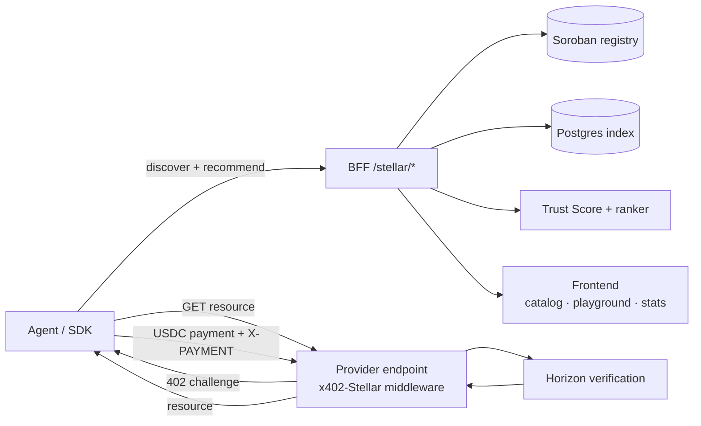

# HANDLE

> Discovery, reputation, and x402 payments for agent-to-agent commerce on Stellar.

<p align="center">
  
  
  
  
</p>

HANDLE is a Stellar-native layer for agentic payments. It lets an agent:

1. **Discover** APIs registered in a Soroban registry contract.
2. **Rank** them with a deterministic, auditable Trust Score.
3. **Pay** for a call with native USDC over x402-Stellar.
4. **Observe** provider and category activity from the resulting payment data.

The current build is a **testnet proof of concept**. It is not a facilitator, a
generic multi-chain analytics product, or a production payments service. Stellar
Public deployment is blocked until the
[mainnet go-live checklist](docs/stellar-mainnet-go-live-checklist.md) has a
signed `GO` decision.

> **Brand note:** the product used to be called Flovia. Some package identifiers
> still use `@flovia/*` and the SDK still exports a `Flovia` class; those are
> compatibility names, not the product name.

---

## How it works



The Soroban registry is the source of truth for provider identity. The indexer
mirrors registry events and payment records into Postgres; the BFF exposes that
read model without calling live RPC on the request path. Payment verification
always happens server-side against Horizon, never from client-supplied data.

---

## What is implemented today

| Capability | Where | Notes |
| --- | --- | --- |
| Provider registry and payment log | [`contracts/soroban-registry/`](contracts/soroban-registry/) | Soroban contract: `register_provider`, `update_provider`, `deactivate`, `log_payment`, and read methods. |
| x402 over Stellar | [`packages/x402-stellar/`](packages/x402-stellar/) | HTTP 402 challenge, native USDC payment, Horizon verification, memo challenge binding, and tx-hash replay protection. |
| Agent SDK | [`packages/agent-sdk/`](packages/agent-sdk/) | `discover()`, `recommend()`, `pay()`, and `discoverAndCall()` in one call. |
| Deterministic scoring | [`packages/intelligence/`](packages/intelligence/) | `trust.ts` computes an explainable Trust Score; `ranker.ts` filters by category and price. No black-box ML. |
| Shared contracts | [`packages/contracts/`](packages/contracts/) | Zod schemas for `StellarProvider`, `ProviderIntelligence`, `StatsOverview`, and the legacy Phase B API. |
| Stellar API | [`apps/bff/`](apps/bff/) | Read-only `/stellar/health`, `/stellar/providers`, `/stellar/recommend`, `/stellar/providers/:id`, and `/stellar/providers/:id/intelligence`, plus a POST-only `/stellar/playground/pay` demo route. |
| Indexer | [`apps/cli/indexer.ts`](apps/cli/indexer.ts) | Reads Soroban events into Postgres. [`apps/cli/scripts/seed-providers.ts`](apps/cli/scripts/seed-providers.ts) seeds testnet providers. |
| Web UI | [`apps/frontend/`](apps/frontend/) | Landing page (EN/ES), provider catalog and detail, agent playground, and live stats dashboard. |
| Fee sponsorship policy | [`docs/stellar-sponsored-fees.md`](docs/stellar-sponsored-fees.md) | Testnet-only, opt-in `decideSponsorship` helper. No automatic fee-bump signer/submitter; disabled on Public. |

---

## Why Stellar

- **Native USDC** settles directly on Stellar with no wrapped-asset hop.
- **Low fees and ~5s finality** make per-call payments practical for agents.
- **Soroban** gives provider identity and payment history a shared on-chain
  source of truth instead of a private catalog.
- **Horizon verification** gives the middleware an authoritative payment fact
  to check before serving a paid resource.

Scoring is intentionally deterministic: the Trust Score combines registration
age, payment volume, verification status, disputes, and recency, and the UI
shows the breakdown so a score can be explained rather than trusted blindly.

---

## Quick start

Requirements:

- Bun `>=1.3.13`
- Node.js `>=20` for the Next.js frontend
- A local database for the BFF/indexer when running the live demo

```sh
bun install
cp -n .env.example .env
bun run verify
```

For the Stellar demo, set at least the following in the repository-root `.env`
(the defaults for Horizon and Soroban RPC already point at testnet):

```dotenv
STELLAR_NETWORK=testnet
HORIZON_URL=https://horizon-testnet.stellar.org
SOROBAN_RPC_URL=https://soroban-testnet.stellar.org
REGISTRY_CONTRACT_ID=C...
DATABASE_URL=...
```

Do not commit `.env`, seeds, or any `S...` secret key. See
[`docs/FLOVIA-STELLAR.md`](docs/FLOVIA-STELLAR.md) for the full historical
environment-variable reference.

Start the demo stack:

```sh
bun --filter bff start       # read-only API, default localhost:3001
bun --filter frontend dev    # Next.js UI, default localhost:3000
```

Or run BFF and frontend together:

```sh
docker compose up --build
```

`bun run verify` is offline by design: it runs import-boundary checks,
typecheck, tests, and offline verification without live RPC or external
services.

### Agent example

```ts
import { Flovia } from "@flovia/agent-sdk";

// The exported class is still named Flovia pending the package rename.
const handle = new Flovia({ secret: process.env.AGENT_SECRET! });
const result = await handle.discoverAndCall({
  need: "fx-rates",
  maxPrice: 0.01,
});

console.log(result.provider.name, result.payment.txHash);
```

The agent needs a funded Stellar testnet account (XLM for fees, USDC to spend).
Fee sponsorship is a policy helper today, not an automatic signer.

---

## Repository layout

| Path | Role |
| --- | --- |
| `contracts/soroban-registry/` | Rust Soroban registry and payment-log contract. |
| `packages/x402-stellar/` | HTTP 402 middleware, client, verification, and replay cache. |
| `packages/agent-sdk/` | Agent-side discovery, ranking, payment, and consumption. |
| `packages/contracts/` | Shared Zod contracts and normalization helpers. |
| `packages/intelligence/` | Trust Score, ranker, joins, and snapshot logic. |
| `packages/sources/` | Adapters for Stellar Horizon/Soroban, KYB, and legacy fixture sources. |
| `apps/bff/` | API layer, including all `/stellar/*` routes. |
| `apps/frontend/` | HANDLE landing, provider, playground, and stats UI. |
| `apps/cli/` | Indexer, provider seeding, reporting, and legacy snapshot commands. |
| `apps/data/`, `apps/demo-provider/` | Database tooling and a demo x402 provider. |
| `docs/` | Specs, status, worklogs, and release gates. |

Packages consume other packages; apps consume packages. `packages/* -> apps/*`
and `apps/bff -> apps/cli` imports are forbidden and checked by
`bun run check:imports`.

---

## Legacy and demo-only surfaces

These parts of the repository are kept for reference and regression coverage.
They are **not** the HANDLE-on-Stellar product path:

- **Solana / MPP showcase** — `apps/frontend/app/showcase/solana-mpp/`,
  `apps/frontend/app/showcase/{hitpay-mpp,stripe-mpp}/`, related
  `apps/frontend/components/showcase/*`, and the `SOLANA_MPP_*`,
  `HITPAY_*`, `STRIPE_*`, and `MPP*` variables in `.env.example`. **Demo-only.**
  Do not extend these into a second production rail.
- **Fixture-backed market-intelligence demo** — `apps/cli` snapshot commands,
  the legacy `/customers`, `/wallet-usage-graph`, and `/analytics/*` BFF
  endpoints, the CDP/Bitquery adapters in `packages/sources`, and the Phase B
  fixtures in `docs/phase-b/`. These model agentic-payment signals with saved
  fixtures and mock attribution; they are not Stellar discovery, scoring, or
  payment truth.
- **Older Flovia-branded docs** — `docs/FLOVIA-STELLAR.md`,
  `docs/01-PRD.md` through `docs/11-MIGRACION-PACKAGES-SOURCES.md`, and
  `docs/product-direction.md` are historical design material. For release
  decisions use `docs/stellar-mainnet-go-live-checklist.md` and
  `docs/stellar-sponsored-fees.md` instead.
- **Package identifiers** — `@flovia/x402-stellar`, `@flovia/agent-sdk`, and
  the `Flovia` SDK class remain until a coordinated rename lands.

New work should target the Stellar path: Soroban registry → indexer → BFF
`/stellar/*` → Trust Score/ranker → x402-Stellar → Horizon verification.

---

## Verification and release gates

```sh
bun run verify        # import boundaries, typecheck, tests, offline verification
bun run test          # test suite
bun run typecheck     # strict TypeScript check
bun run format        # format TypeScript / JSON with Biome
bun run format:check  # check formatting
```

Live network checks are intentionally separate from `verify`. Stellar Public
remains `NO-GO` until the security prerequisites, testnet evidence, WASM
verification, and signed go/no-go decision in
[`docs/stellar-mainnet-go-live-checklist.md`](docs/stellar-mainnet-go-live-checklist.md)
are complete.
